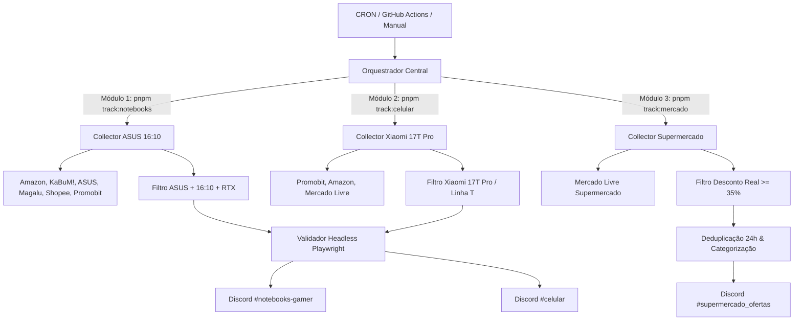

# ⚡ Price Tracker

> **Sistema modular e automatizado de monitoramento de preços, cálculo de custo real (à vista + frete regional), validação headless via Playwright e alertas no Discord.**

[](https://github.com/AdleyRodrigues/price-tracker/actions/workflows/monitor.yml)
[](https://github.com/AdleyRodrigues/price-tracker/actions/workflows/celular.yml)
[](https://github.com/AdleyRodrigues/price-tracker/actions/workflows/supermercado.yml)
[](https://github.com/AdleyRodrigues/price-tracker)
[](LICENSE)

---

## 📖 Origem & Evolução do Projeto (Veio pelo LinkedIn? 👋)

Se você chegou aqui através da minha [publicação no LinkedIn](https://www.linkedin.com/in/adley-castro/), seja muito bem-vindo!

### ❄️ Como tudo começou: *O robô caçador de Ar-Condicionado LG*
O projeto nasceu de uma dor pessoal muito comum ao comprar eletrodomésticos na internet:
1. **Confusão de SKUs e Modelos:** Uma única letra no código do produto (como `S3-Q09AA31F` vs `S3-Q09AA33F`) pode significar serpentina de alumínio em vez de cobre ou a ausência de comandos de voz e inteligência artificial.
2. **A Ilusão do "Preço de Vitrine":** Muitas lojas exibem um valor atraente na busca, mas ao informar o CEP, o frete abusivo anula qualquer desconto real.
3. **Trabalho Braçal e Repetitivo:** Abrir 5 a 10 abas diariamente em lojas diferentes para verificar oscilações de preço.

Para resolver isso, criei um script de automação e web scraping focado no modelo exato do **LG Dual Inverter Voice 9.000 BTUs**:
* Variava simultaneamente a **Loja Oficial LG**, **Amazon Brasil** e a comunidade do **Promobit**;
* Ignorava produtos similares ou modelos inferiores via regex rigoroso de SKU;
* Calculava automaticamente o **frete para o CEP de destino**, somava ao preço à vista e gerava o **Custo Total Real**;
* Enviava diariamente um **Top 3 (Pódio)** no Discord pelo menor preço final.

---

### 🔄 A Evolução: *De LG Tracker para um Price Tracker Modular*
Após o objetivo original ser concluído com sucesso e o ar-condicionado comprado no melhor preço histórico, decidi não descartar a ferramenta.

Por ser um projeto pessoal e vivo, **desacoplei o domínio rígido de ar-condicionado e transformei o repositório em uma engine genérica e modular de monitoramento**. Hoje, basta plugar novos scrapers, filtros e regras para rastrear qualquer categoria de produto conforme as minhas necessidades de consumo atuais:
* 💻 **Notebooks ASUS com tela 16:10 e placa RTX 4060, 5050 ou 5060** (com parcelamento, cupons e validação Playwright).
* 📱 **Smartphones Xiaomi 17T Pro e Linha T** (Amazon, Mercado Livre e Promobit).
* 🛒 **Achados de Supermercado** (>35% OFF no Mercado Livre).

---

## 🎯 Módulos Atualmente Ativos



---

### 1. 💻 Monitor ASUS 16:10 (RTX 4060 / RTX 5050 / RTX 5060)
* **Ponto de entrada:** `src/tracker.ts` (`pnpm start` ou `pnpm track:notebooks`)
* **Lojas monitoradas:** Amazon Brasil, KaBuM!, Loja Oficial ASUS, Magazine Luiza, Shopee e Promobit.
* **Filtros de Hardware:** Exige cumulativamente `Notebook ASUS` + `Tela 16:10` + `RTX 4060, 5050 ou 5060`.
* **Condições Financeiras & Cupons:** Preço à vista (Pix), parcelamento discriminado sem juros e menor custo real com cupons.
* **Alertas no Discord:** Canal `#notebooks-gamer` com pódio e ping em ofertas críticas.

---

### 2. 📱 Monitor Xiaomi 17T Pro (e Linha T)
* **Ponto de entrada:** `src/tracker-celular.ts` (`pnpm track:celular`)
* **Lojas monitoradas:** Amazon Brasil, Mercado Livre e Comunidade Promobit.
* **Filtros de Hardware:**
  - **Inclusão:** Exige cumulativamente marca `Xiaomi / Mi` e modelo `17T Pro`, `17T`, `14T Pro` ou `15T Pro`.
  - **Exclusão:** Bloqueia automaticamente capas, películas, carregadores, cabos, fones/earbuds, smartwatches, peças/telas e réplicas.
  - **Piso de Corte:** R$ 1.800,00 (elimina acessórios).
* **Alertas no Discord:** Canal `#celular` com pódio das melhores ofertas e destaque para desconto com cupom.

---

### 3. 🛒 Monitor de Achados de Supermercado (Mercado Livre)
* **Ponto de entrada:** `src/tracker-supermercado.ts` (`pnpm track:mercado`)
* **Lojas monitoradas:** Vitrines e promoções do Mercado Livre Supermercado.
* **Critérios de Curadoria:**
  - Filtra produtos com **pelo menos 35% de desconto real**.
  - Categorização automática em: *🧼 Limpeza*, *🥫 Alimentos & Bebidas* e *🪥 Higiene Pessoal*.
* **Alertas no Discord:** Canal `#supermercado_ofertas` com janela de 24h anti-repetição.

---

## 🏗️ Arquitetura do Repositório

```text
price-tracker/
├── src/
│   ├── config/
│   │   ├── catalogo.ts             # Alvos de busca e parâmetros de produtos
│   │   ├── regras.ts               # Regex de notebooks (ASUS 16:10 RTX), fretes e pisos
│   │   ├── regras-celular.ts       # Regras e URLs para Xiaomi 17T Pro / Linha T
│   │   ├── regras-supermercado.ts  # URLs e thresholds de desconto de supermercado
│   │   ├── env.ts                  # Carregamento seguro e tipado de variáveis de ambiente
│   │   └── http.ts                 # Cliente Axios com User-Agents reais e timeouts
│   ├── domain/
│   │   ├── filtros.ts              # Regras de notebooks (ASUS, Tela 16:10, GPU)
│   │   ├── filtros-celular.ts      # Regras de inclusão/exclusão de smartphones
│   │   ├── filtros-supermercado.ts # Regras e categorização de supermercado
│   │   └── ranking.ts              # Ordenação por custo real e formação de pódio
│   ├── scrapers/
│   │   ├── amazon.ts               # Parser de vitrines e buyboxes da Amazon
│   │   ├── promobit.ts             # Scraper de API JSON e cards HTML do Promobit
│   │   ├── kabum.ts                # Parser de PDPs da KaBuM!
│   │   ├── asus.ts                 # Parser de PDPs da Loja Oficial ASUS
│   │   ├── magalu.ts               # Parser de PDPs do Magazine Luiza
│   │   ├── shopee.ts               # Parser de links da Shopee
│   │   ├── celular.ts              # Coletor integrado para Xiaomi 17T Pro
│   │   ├── mercado-livre-supermercado.ts # Coletor de promoções do Mercado Livre
│   │   └── index.ts                # Registry central de scrapers ativos
│   ├── services/
│   │   ├── collector.ts            # Fan-out paralelo e deduplicação de ofertas
│   │   ├── discord.ts              # Despachante de embeds de notebooks (#notebooks-gamer)
│   │   ├── discord-celular.ts      # Despachante de embeds de celulares (#celular)
│   │   ├── discord-supermercado.ts # Despachante de embeds de supermercado (#supermercado_ofertas)
│   │   ├── alertas-enviados.ts     # Cache local de ofertas já notificadas
│   │   └── verificador-playwright.ts # Validador headless com bloqueio de recursos
│   ├── tracker.ts                  # Orquestrador do monitor de notebooks
│   ├── tracker-celular.ts          # Orquestrador do monitor de Xiaomi 17T Pro
│   └── tracker-supermercado.ts     # Orquestrador do monitor de supermercado
├── .github/workflows/
│   ├── monitor.yml                 # CI/CD: Notebooks ASUS 16:10
│   ├── celular.yml                 # CI/CD: Xiaomi 17T Pro (e Linha T)
│   └── supermercado.yml            # CI/CD: Supermercado
├── tests/                          # Suíte com 90 testes automatizados (Vitest)
├── package.json
└── tsconfig.json
```

---

## 🚀 Como Rodar o Bot por Conta Própria

### Pré-requisitos
* **Node.js 20+**
* **pnpm** (`npm i -g pnpm`)

### 1. Clonar e Instalar
```bash
git clone https://github.com/AdleyRodrigues/price-tracker.git
cd price-tracker
pnpm install
```

### 2. Configurar Variáveis de Ambiente (`.env`)
Crie um arquivo `.env` na raiz do projeto:
```env
# Webhook do Discord para Notebooks (#notebooks-gamer)
WEBHOOK_URL="https://discord.com/api/webhooks/SEU_WEBHOOK_NOTEBOOKS"

# Webhook do Discord para Smartphones Xiaomi (#celular)
DISCORD_CELULAR_WEBHOOK_URL="https://discord.com/api/webhooks/SEU_WEBHOOK_CELULAR"

# Webhook do Discord para Supermercado (#supermercado_ofertas)
DISCORD_SUPERMERCADO_WEBHOOK_URL="https://discord.com/api/webhooks/SEU_WEBHOOK_SUPERMERCADO"

# CEP regional para cálculo de frete e custo real
CEP_DESTINO="01001-000"

# (Opcional) ID do usuário no Discord para ser mencionado em super promoções
USER_ID="123456789012345678"
```

### 3. Executar os Rastreadores
```bash
# Executar monitor de Notebooks Gamer ASUS 16:10
pnpm track:notebooks

# Executar monitor de Smartphones Xiaomi 17T Pro / Linha T
pnpm track:celular

# Executar monitor de Supermercado (Mercado Livre)
pnpm track:mercado
```

### 4. Rodar a Suíte de Testes
```bash
pnpm test
```

---

## ☁️ Automação 100% Serverless no GitHub Actions

| Workflow | Frequência | Canal Discord |
|----------|------------|---------------|
| **Monitor - ASUS 16:10** (`monitor.yml`) | A cada 4 horas (`0 */4 * * *`) | `#notebooks-gamer` |
| **Monitor - Xiaomi 17T Pro** (`celular.yml`) | A cada 4 horas (`0 */4 * * *`) | `#celular` |
| **Monitor - Supermercado** (`supermercado.yml`) | A cada 2 horas (`0 */2 * * *`) | `#supermercado_ofertas` |

---

## 📄 Licença

Distribuído sob a licença ISC. Desenvolvido por **[Adley Rodrigues](https://github.com/AdleyRodrigues)**.
